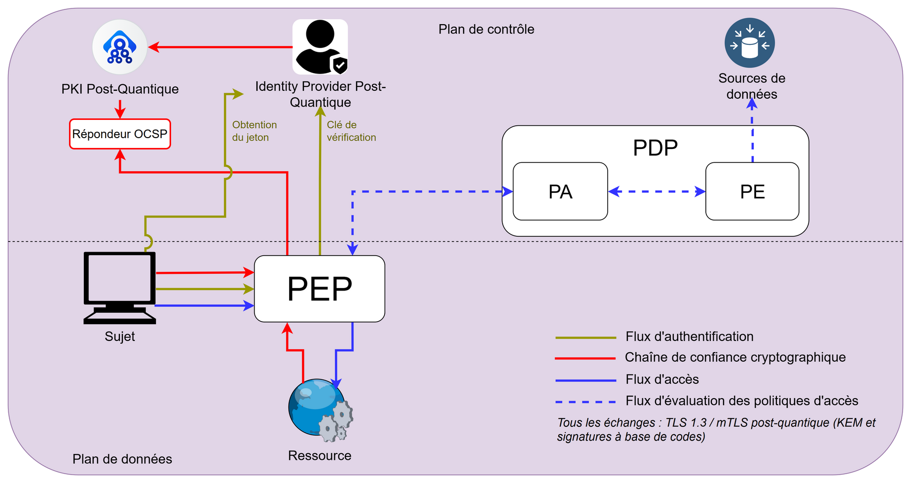

# Simulateur PQC-Zero Trust

Prototype du mémoire de Master 2 Réseaux et Télécommunications *« Conception et
évaluation d'une architecture Zero Trust post-quantique basée sur la
cryptographie à codes correcteurs d'erreurs (PQC-Zero Trust) »*.

L'architecture suit le modèle du NIST SP 800-207. Toute sa cryptographie
asymétrique repose sur les codes correcteurs d'erreurs :

* **HQC-1** (HQC-128) pour l'échange de clés de TLS 1.3 ;
* **CROSS-RSDP-128-balanced** pour les signatures des certificats, des jetons
  et des réponses OCSP.

Le **même code** est mesuré en configuration classique (**X25519 + RSA-3072**)
et post-quantique : seul le fichier `env/<mode>.env` change.

## Architecture



*Architecture PQC-ZT (NIST SP 800-207) : tous les échanges passent par TLS 1.3 / mTLS post-quantique (HQC pour l'échange de clés, CROSS pour les signatures).*

Chaque composant tourne dans son propre conteneur Docker
(`docker-compose.v2.yml`) :

| Conteneur | Rôle | Port interne |
|---|---|---|
| `zt2-pki` | Autorité de certification, inscription des composants par CSR, révocation, répondeur OCSP | 8447 |
| `zt2-idp` | Fournisseur d'identité : authentifie l'utilisateur et émet un jeton JWT signé (CROSS ou RSA) | 8444 |
| `zt2-pep` | Point d'application (PEP), seul point de passage : vérifie le jeton ou le certificat client, interroge l'OCSP et le PDP, relaie vers la ressource | 8443 |
| `zt2-pdp` | Point de décision (PDP) : OPA (politique Rego, refus par défaut), joignable uniquement par une passerelle mTLS post-quantique | 8182 (OPA en local sur 8181) |
| `zt2-ressource` | Ressource protégée, accessible uniquement en mTLS depuis le PEP | 8446 |

Principes appliqués :

* **Aucune clé privée partagée** : chaque composant génère sa propre clé et
  obtient son certificat auprès de la PKI. Seule l'ancre de confiance est
  partagée (volume `trust`, en lecture seule).
* **Révocation** : le PEP vérifie le statut des certificats clients par OCSP,
  avec un cache de 60 s par défaut (`OCSP_CACHE_TTL`).
* **Durées de vie courtes** : certificats de 2 jours (`CERT_DAYS`), connexions
  réutilisées au plus 15 minutes (`ZT_MAX_CONN_LIFETIME`).
* **Micro-segmentation** : un réseau Docker par lien (`net_idp`, `net_pdp`,
  `net_s2s` et un réseau vers la PKI par composant). Deux composants qui ne
  partagent pas de réseau ne peuvent pas communiquer.
* **Refus par défaut** : en l'absence de décision, de réponse OCSP ou de preuve
  valide, le PEP refuse.

Seuls le PEP, l'IdP et la PKI sont publiés sur l'hôte, sur `127.0.0.1` par
défaut (ports 18443, 18444 et 18447, adresse réglable par `PUBLISH_ADDR`).

## Configurations mesurées

| | Classique (`env/classical.env`) | Post-quantique (`env/pqc.env`) |
|---|---|---|
| Échange de clés TLS 1.3 | X25519 | HQC-1 |
| Certificats, jetons, OCSP | RSA-3072 | CROSS-RSDP-128-balanced |
| Niveau de sécurité | 128 bits classiques | catégorie 1 du NIST |

Versions figées : OpenSSL 3.5.8, liboqs 0.16.0 (commit `be7ecb9`),
oqs-provider 0.12, liboqs-python 0.16.0, OPA 1.20.2 (détail dans
[REPRODUIRE.md](REPRODUIRE.md)).

## Démarrage rapide (un hôte Linux)

```bash
sudo bash deploy/bootstrap_host.sh   # Docker et Compose (une fois)
scripts/zt2.sh pull                  # image des mesures depuis Docker Hub
scripts/zt2.sh tokens                # jetons d'inscription (env/tokens.env)
scripts/zt2.sh up pqc                # démarre l'architecture (pqc ou classical)
scripts/validate_v2.sh               # vérifie la micro-segmentation et le contrôle d'accès
scripts/zt2.sh down                  # arrête et efface (CA comprise)
```

`scripts/zt2.sh build` reconstruit l'image depuis les sources au lieu de la
télécharger (20 à 30 minutes sur 2 vCPU).

## Mesures

Le banc `metrics/bench_v2.py` mesure, sur 100 échantillons (médiane, p05, p95) :

* la taille des objets : certificats, jeton, clé publique de l'IdP, réponse OCSP ;
* le handshake TLS 1.3 vers le PEP, avec et sans certificat client : durée,
  octets échangés, et durée de l'ouverture TCP comme estimation du RTT ;
* le flux utilisateur (jeton puis accès) et le flux de service à service (mTLS + OCSP) ;
* le débit avec quatre clients simultanés pendant 15 s ;
* le délai de prise en compte d'une révocation.

`scripts/zt2.sh matrix <env> 100` enchaîne, pour chaque mode, une configuration
de référence et cinq variantes :

| Variante | Paramètre modifié |
|---|---|
| `reuse1` (référence) | connexions réutilisées, cache OCSP de 60 s, chaîne sans la racine |
| `reuse0` | nouvelle connexion TLS pour chaque requête |
| `root` | le serveur envoie aussi le certificat de l'autorité |
| `ttl0` | OCSP sans cache |
| `noocsp` | vérification de révocation désactivée |
| `nagle` | algorithme de Nagle rétabli côté serveur (`TCP_NODELAY` désactivé) |

Les campagnes sur plusieurs hôtes (`scripts/campaign.sh`) et le déploiement AWS
par Terraform (`deploy/aws/`) sont décrits dans [REPRODUIRE.md](REPRODUIRE.md).

## Résultats du mémoire

`results-memoire/2026-10-31/` contient les 36 fichiers JSON bruts de la
campagne du chapitre 4 et leur synthèse `summary.csv`, pour quatre
environnements :

| Étiquette | Architecture | Client de mesure |
|---|---|---|
| `vm` | VM locale | même hôte |
| `aws` | instance AWS à Londres | même instance |
| `useast` | instance AWS à Londres | instance AWS en Virginie |
| `vmaws` | instance AWS à Londres | VM locale, par l'accès Internet du poste |

Principaux résultats :

* les objets post-quantiques sont dix à vingt fois plus volumineux ; le vol du
  serveur passe de 2 Ko à 31,7 Ko ;
* un handshake post-quantique coûte environ 12 ms de calcul de plus et, sur un
  réseau étendu, un aller-retour supplémentaire ;
* avec la réutilisation des connexions et le cache OCSP, l'accès d'un service
  entre la Virginie et Londres coûte 82,3 ms dans les deux configurations.

Les figures du chapitre se régénèrent avec :

```bash
python3 metrics/plots_v2.py results-memoire/2026-10-31 media/
```

## Limites

* Prototype de recherche écrit en Python, sur de petites instances : les durées
  absolues seraient plus faibles avec une implémentation compilée ; les
  comparaisons restent valides car elles portent sur le même code et le même hôte.
* PA et PE sont fusionnés dans le PDP (OPA).
* L'algorithme de signature CROSS n'a pas d'identifiant JWS enregistré à l'IANA.
* CROSS n'a pas été retenu par le NIST en 2026 : il sert ici de cas le plus
  défavorable pour la taille des signatures, pas de recommandation de déploiement.
* Les utilisateurs sont statiques et aucune attaque n'est simulée : la
  micro-segmentation est vérifiée au niveau de la configuration.

## Arborescence

```
docker-compose.v2.yml   architecture (5 conteneurs, réseaux par lien)
env/                    classical.env, pqc.env (tokens.env généré)
docker/                 Dockerfile.base (OpenSSL, liboqs, oqs-provider), Dockerfile (services)
pkisvc/                 PKI : CA, inscription, révocation, OCSP
idp/  pep/  pdp/        fournisseur d'identité, PEP, politiques OPA
ressource/              ressource protégée
common/                 inscription, client OCSP, passerelle mTLS, serveur HTTPS keep-alive
metrics/                bench_v2.py (banc), aggregate_v2.py, plots_v2.py
scripts/                zt2.sh (un hôte), campaign.sh (plusieurs hôtes), validate_v2.sh
deploy/                 bootstrap_host.sh, aws/ (Terraform)
results-memoire/        résultats bruts du mémoire
docs/                   schéma de l'architecture
```

Les autres fichiers (`docker-compose.yml`, `metrics/bench_*.py` autres que
`bench_v2.py`, `metrics/run_*/`, `pki/scripts/`) proviennent d'une étape de
développement antérieure ; ils ne servent pas aux mesures du mémoire.
